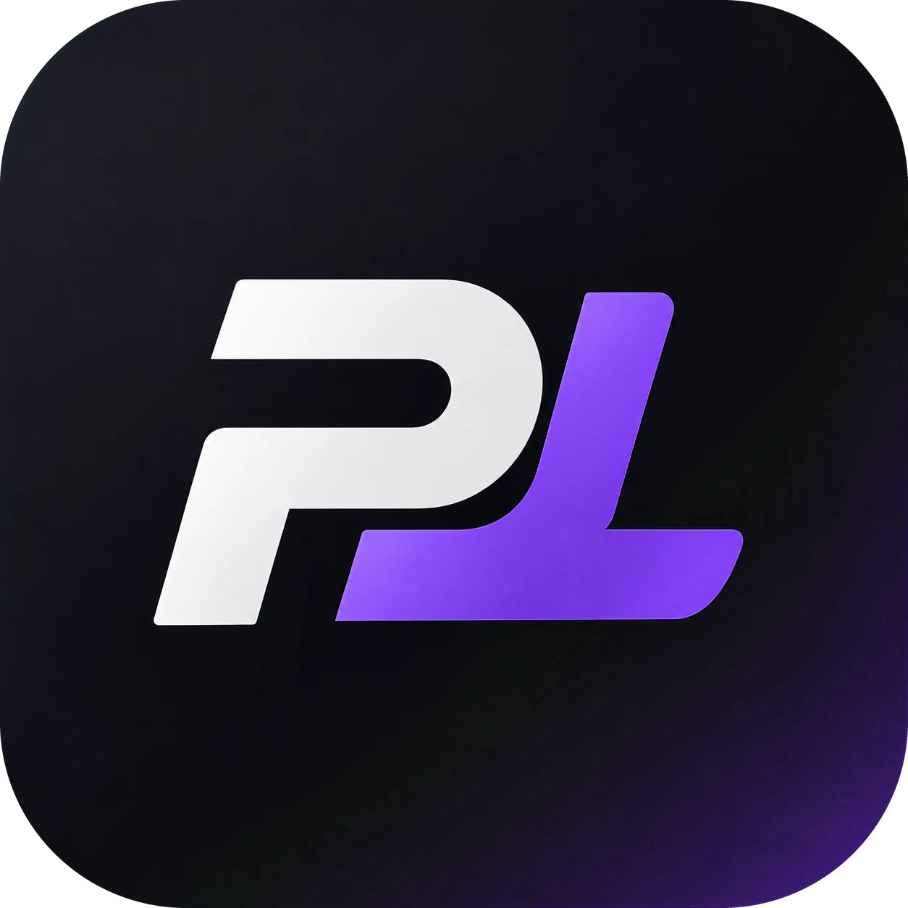

<p align="center"></p>

# PortuLang

Linguagem de programação **em português**, com declaração obrigatória de tipos
(`inteiro`, `decimal`, `texto`, `logico`). Projeto de Compiladores – FANS (Engenharia de Software).

É **compilada para Python e depois interpretada** (híbrida): o código passa por análise léxica, sintática e
semântica e vira um programa `.py`; o Python o executa. Os programas PortuLang são arquivos `.pl`.

```
programa
    texto nome;
    decimal nota1;
    decimal nota2;

    escrever("Qual o seu nome? ");
    ler(nome);
    escrever("Nota 1: ");
    ler(nota1);
    escrever("Nota 2: ");
    ler(nota2);

    decimal media = (nota1 + nota2) / 2;
    se (media >= 7) {
        escrever(nome, " foi aprovado(a) com ", media);
    } senao {
        escrever(nome, " nao passou, media ", media);
    }
fim
```

## PortuLang Studio

Uma ferramenta visual que mostra, passo a passo e com uma cena 3D, o que o compilador faz com o seu código.

### Windows: sem instalar nada

Baixe o `PortuLang-windows.zip`, extraia e abra `PortuLang.exe`. Abre numa janela própria (usa o WebView2, que já
vem no Windows 11). Se o SmartScreen avisar, clique em *Mais informações → Executar assim mesmo* (o programa ainda não
tem assinatura digital).

Para gerar o zip você mesmo: `powershell -File build_exe.ps1` (precisa de Python 3.11+).

### Qualquer sistema, pelo navegador

```
python -m studio          # abre http://127.0.0.1:8765 (ou dê dois cliques em abrir_studio.bat)
```

Passo a passo guiado, em 6 etapas, com cena 3D (three.js r186, incluído em `studio/static/vendor`, funciona offline):

1. **Escrever**: editor com exemplos, *Abrir* / *Salvar* de arquivos `.pl`, e o caminho que o código vai percorrer.
2. **Léxico**: cada palavra do código vira uma peça colorida num tabuleiro; tabela de tokens.
3. **Sintático**: as peças viram uma árvore; passar o mouse num bloco acende o trecho do código. Com erro, mostra a árvore parcial e marca onde quebrou.
4. **Semântico**: selos de tipo em cada nó, tabela de símbolos, erros em vermelho.
5. **Código**: o programa traduzido para Python (e, noutra aba, as instruções de uma máquina de pilha), ligado ao código-fonte linha a linha. Dá para baixar o `.py`.
6. **Executar**: caixas de variável, tela e um robô; você digita os valores pedidos por `ler()` na própria tela, com play/pausa e uma frase explicando cada passo.

Cada fase roda no servidor (Python) só quando você chega nela, e o Studio mostra o tempo real que levou. Se houver erro
em qualquer etapa, ela explica em português e o botão "Corrigir no código" leva ao ponto do problema.

Mouse na cena: roda = zoom · Ctrl + roda = subir/descer · arrastar = mover · botão direito (ou Ctrl + arrastar) = girar.

## Linha de comando

```
python -m portulang exemplos/01_idade.pl                 # executa
python -m portulang exemplos/01_idade.pl --tokens        # fase léxica
python -m portulang exemplos/01_idade.pl --ast           # árvore sintática
python -m portulang exemplos/01_idade.pl --simbolos      # tabela de símbolos
python -m portulang exemplos/01_idade.pl --json          # tudo em JSON (para o Studio)
python -m unittest discover -s tests                     # testes
```

## Estrutura

| Fase | Arquivo |
|---|---|
| Tokens | `portulang/tokens.py` |
| Análise léxica | `portulang/lexer.py` |
| AST | `portulang/ast_nodes.py` |
| Análise sintática | `portulang/parser.py` |
| Análise semântica | `portulang/semantico.py` |
| Geração de código (Python) | `portulang/transpilador.py` |
| Código de máquina de pilha + máquina virtual | `portulang/codigo.py` |
| Interpretador da árvore | `portulang/interpretador.py` |
| Erros (L/P/S/E) | `portulang/erros.py` |
| Servidor do Studio | `studio/server.py` |
| Aplicativo de janela | `desktop.py` |

`portulang.analisar(fonte)` devolve tokens, AST, tabela de símbolos e erros;
`portulang.executar(fonte, entrada, saida, observador=...)` também executa.
O `observador` é chamado antes de cada comando com as variáveis visíveis (base da execução passo a passo do Studio).
Cada nó da AST guarda a faixa de tokens que cobre (`ti`/`tf`), e cada passo da execução traz o que o comando fez —
é isso que liga cena, código e explicações. Os testes conferem que o Python gerado e a máquina virtual dão o mesmo
resultado que o interpretador.

## Autores

Mateus Artur, Rafael Araújo e Otávio de Pádua.
